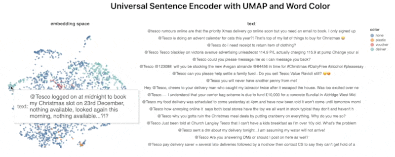
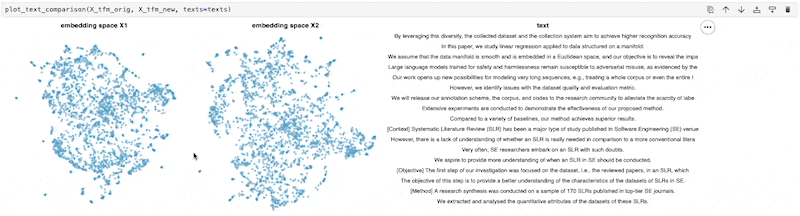

### cluestar

> Gain a clue by clustering!

This library contains visualisation tools that might help you
get started with classification tasks. The idea is that if you
can inspect clusters easily, you might gain a clue on what
good labels for your dataset might be!

It generates charts that looks like this:



There's even a fancy chart that can compare embedding techniques.



## Install

```text
python -m pip install cluestar
```

## Interactive Demo

You can see an interactive demo of the generated widgets [here](https://koaning.github.io/cluestar/).

You can also toy around with the demo notebook found [here](https://github.com/koaning/cluestar/blob/main/notebooks/overview.ipynb).

## Usage

The first step is to encode textdata in two dimensions, like below.

```python
from sklearn.pipeline import make_pipeline
from sklearn.decomposition import TruncatedSVD
from sklearn.feature_extraction.text import TfidfVectorizer

pipe = make_pipeline(TfidfVectorizer(), TruncatedSVD(n_components=2))

X = pipe.fit_transform(texts)
```

From here you can make an interactive chart via;

```python
from cluestar import plot_text

plot_text(X, texts)
```

The best results are likely found when you use
[umap](https://umap-learn.readthedocs.io/en/latest/)
together with something like
[universal sentence encoder](https://koaning.github.io/whatlies/api/language/universal_sentence/).

Drag a rectangle over the scatter plot to select points. The panels on the right
update as you drag:

- **"293 of 2,000 selected"**: how many points are in your selection.
- **text**: the first few texts in the selection (hover a point to see its full text).
- **top words**: the words that appear in the most selected texts, ignoring common filler
  words, URLs and @mentions. Use `top_words=0` to hide this panel.

Double-click the scatter plot to clear the selection.

### Coloring points

You might also improve the understandability by highlighting points
that have a certain word in it.

```python
plot_text(X, texts, color_words=["plastic", "voucher", "deliver"])
```

You can also color by an array. Floats, like predicted probabilities, get a color scale.

```python
# First, get an array of probabilities from some model
p_vals = some_model.predict_proba(texts)[:, 0]
plot_text(X, texts, color_array=p_vals)
```

Anything else, like cluster ids, labels you already have or booleans, is treated as
categories. **Click a category in the legend** to show only that group; the count, text
and top words panels then only describe that group.

```python
from sklearn.cluster import KMeans

clusters = KMeans(n_clusters=5).fit_predict(X)
plot_text(X, texts, color_array=clusters)
```

### Getting your selection back into Python

Found an interesting cluster? Use `widget=True` and you can pull the selected rows
straight into your notebook, for example to label them or to export them.
This needs one extra package:

```text
python -m pip install "cluestar[widget]"
```

```python
widget = plot_text(X, texts, color_array=clusters, widget=True)
widget  # display it, then drag a rectangle and/or click the legend
```

```python
selected = widget.selected()  # a DataFrame with the text, coordinates and color
selected.index                # positions in `texts`, so df.iloc[selected.index] gets your original rows
```

`widget.selected()` always reflects the current selection, so you can select, run the
cell, select something else and run it again.

### Comparing two embeddings

You can also compare two embeddings interactively. Selecting points in one
chart highlights the same texts in the other.

```python
from cluestar import plot_text_comparison

plot_text_comparison(X1, X2, texts)
```

`plot_text_comparison` takes the same `color_array`, `color_words`, `top_words` and
`widget` arguments as `plot_text`.
